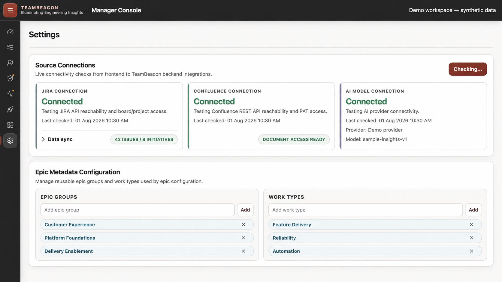
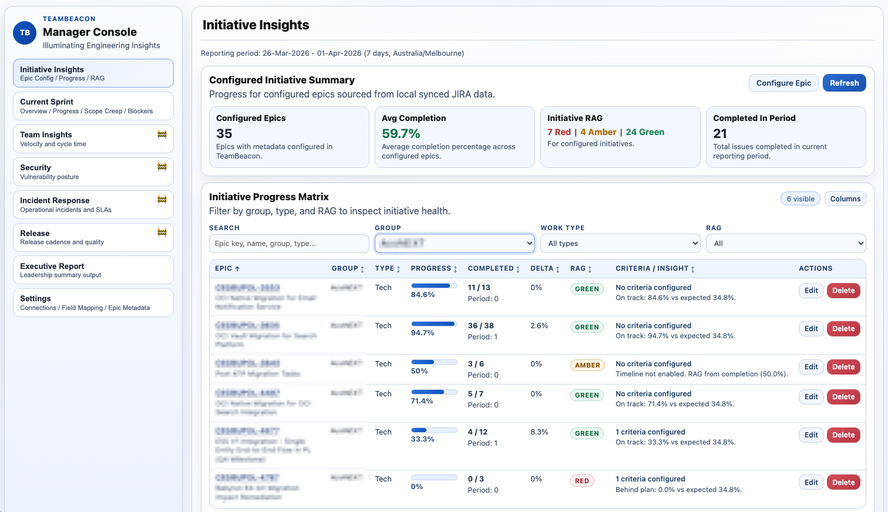
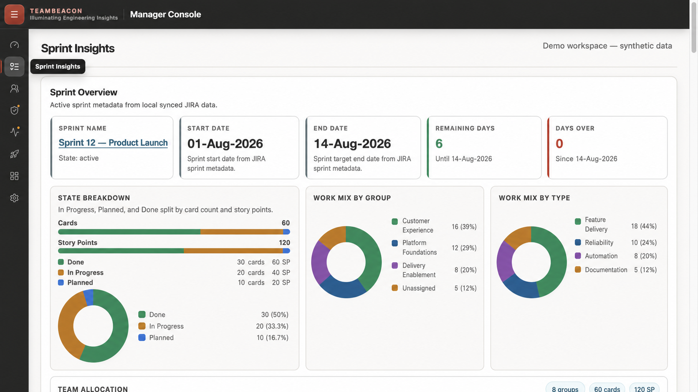
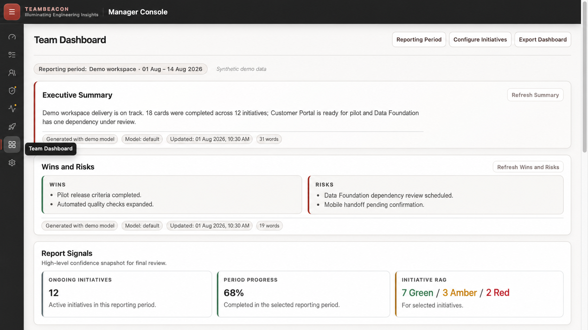

# TeamBeacon

Planner is available immediately after Initiatives. Create a delivery plan, add configured epics, define tracks and dates, and connect finish-to-start dependencies. Save as Active to preserve the original schedule and scope. Plan edits stay local; JIRA and initiative dates are unchanged. The additive Planner schema initializes automatically on first use. See [Planner scope and metric definitions](SPEC.md#51-planner--first-version) and the [architecture](docs/architecture/ARCHITECTURE.md#planner). Forecasting and capacity modelling are planned follow-ups.

TeamBeacon is a self-hosted engineering intelligence web app that sits on top of existing delivery data sources and helps Engineering Managers operate with clearer signals, lower cognitive load, and better delivery outcomes.

## 🎯 Overview
- Containerized workflow that can run locally on the manager's machine.
- Non-destructive integration model (does not modify upstream source data).
- Metadata-driven insight layer (Work Stream/Work Type/Epic configuration).
- AI-powered insights with pluggable provider support (OCI, Ollama, OpenAI).

## ✨ Core Capabilities
- Team Dashboard: default startup view with work-stream flow and delivery progress, latest completed-release health, sprint cycle-time movement, current blockers, and recently completed cards.
- Settings: initiative metadata, work-stream epic mapping, and an Unmapped cards inventory with JIRA links for assigning epics. Source connectivity and sync controls are available in the system-status menu.
- Initiative Insights: progress matrix, filters, and RAG visibility.
- Initiative Deep Dive: default-all and multi-work-stream/epic-scoped weekly intake and completion flow with one persisted preset/custom reporting period shared by the chart and activity table, quick-range shortcuts, and a distinct current-WIP snapshot.
- Team Insights: sprint trend window controls (1/2/3/4/6/8/10/12), completed story points, and cycle-time trend metrics.
- Sprint Insights: state breakdown, work mix, scope-change and blocker visibility.
- Release Insights: release overview, selectable cycle-time trend, overdue readiness, and completed-release quality signals.
- Dashboard completion share measures each work stream’s share of completed cards in the selected flow period, including Unmapped work and counting primary assignments once.
- Team Report: delivery signals, AI-generated completed-work summaries with source links, work-mix charts, and initiative progress for leadership updates.

## 📣 Communication One-Pager
For product messaging, capability narrative, and value framing, see:
- [TeamBeacon Communication One-Pager](docs/communication/communication_one_pager.md)

## 🖼️ Feature Preview
The following live-app captures use a synthetic demo workspace so project, sprint, and operational details remain safe to share.

<table>
  <tr>
    <td align="center">
      <br />
      <sub>Settings Overview</sub>
    </td>
    <td align="center">
      <br />
      <sub>Initiative Insights</sub>
    </td>
  </tr>
  <tr>
    <td align="center">
      <br />
      <sub>Sprint Insights</sub>
    </td>
    <td align="center">
      <br />
      <sub>Team Report</sub>
    </td>
  </tr>
</table>

## 🧱 Repository Layout
```text
TeamBeacon/                  # Repository root
  app/                       # React + Vite web frontend
  services/                  # Runtime services
    api/                     # Local API endpoints and orchestration
  packages/                  # Shared Python packages
    connectors/              # Source connector configs and clients
  docs/                      # Product/architecture/design/ops/communication documentation
    communication/           # Communication one-pager and redacted screenshots
    architecture/            # Architecture reference docs
    design/                  # UI/UX mockups and design notes
    plans/                   # Delivery and implementation plans
    ops/                     # Operational runbooks
  tests/                     # Backend unit/integration test suites
```

## 🛠️ Prerequisites
- `git` for cloning and collaboration.
- `docker` for the fastest TeamBeacon setup.
- `python3` (3.11+ recommended) for API/runtime and backend tests.
- `node` and `npm` (Node 22 recommended, aligned with CI) for frontend build/test.
- `sqlite3` CLI for local DB schema setup and ad-hoc DB checks.
- OCI Python SDK (required only when `INTELLIGENCE_PROVIDER=oci`): `python3 -m pip install oci`

## 🚀 Quick Start (Docker Compose)
1. Clone and enter the repository:
```bash
git clone https://github.com/git-mhaque/TeamBeacon && cd TeamBeacon
```

2. Configure environment variables:
```bash
cp config/.env.example config/.env
```
Configuration details are documented in [config/README.md](config/README.md).

3. Start TeamBeacon:
```bash
docker compose up -d --build

# Optional non-default port:
TEAMBEACON_HOST_PORT=19000 docker compose up -d --build
```

4. Access TeamBeacon:
- `http://localhost:18000`

## 🧪 Local Development (Optional)
1. Clone and enter the repository:
```bash
git clone https://github.com/git-mhaque/TeamBeacon && cd TeamBeacon
```

2. Configure environment variables:
```bash
cp config/.env.example config/.env
```
Configuration details are documented in [config/README.md](config/README.md).

3. Apply local database schema (mandatory before first local run):
```bash
test -f data/teambeacon.db || sqlite3 data/teambeacon.db < services/api/db/migrations/0001_initial.sql
```

4. Start frontend + local API:
```bash
cd app
npm install
npm run dev
```
- Frontend: `http://localhost:5174`
- API: `http://localhost:8000`
- API Swagger UI: `http://localhost:8000/docs`
- API OpenAPI schema: `http://localhost:8000/openapi.json`

5. Run backend tests:
```bash
python3 -m unittest discover -s tests/unit -p "test_*.py" -v
python3 -m unittest discover -s tests/integration/api -p "test_*.py" -v
```

CI also enforces at least 90% combined statement/branch coverage **for each** of
`services/api/server.py`, `services/api/integrations/jira_sync.py`, `services/api/metadata/epic_mapping.py`, `packages/connectors/epic_scope.py`, `services/api/metadata/epic_config.py`, `services/api/issues/team_dashboard.py`, and `services/api/issues/unmapped_cards.py`. In an activated
Python 3.11 virtual environment (the optional `.venv-mcp` environment also works):

```bash
python -m pip install coverage==7.16.2
python -m coverage run --branch --source=services.api.server,services.api.integrations.jira_sync,services.api.metadata.epic_mapping,packages.connectors.epic_scope,services.api.metadata.epic_config,services.api.issues.team_dashboard,services.api.issues.unmapped_cards,services.api.planner -m unittest discover -s tests/unit -p "test_*.py" -v
python -m coverage run --append --branch --source=services.api.server,services.api.integrations.jira_sync,services.api.metadata.epic_mapping,packages.connectors.epic_scope,services.api.metadata.epic_config,services.api.issues.team_dashboard,services.api.issues.unmapped_cards,services.api.planner -m unittest discover -s tests/integration/api -p "test_*.py" -v
python -m coverage report --include=services/api/server.py --precision=2 --fail-under=90
python -m coverage report --include=services/api/integrations/jira_sync.py --precision=2 --fail-under=90
python -m coverage report --include=services/api/metadata/epic_mapping.py --precision=2 --fail-under=90
python -m coverage report --include=packages/connectors/epic_scope.py --precision=2 --fail-under=90
python -m coverage report --include=services/api/metadata/epic_config.py --precision=2 --fail-under=90
python -m coverage report --include=services/api/issues/team_dashboard.py --precision=2 --fail-under=90
python -m coverage report --include=services/api/issues/unmapped_cards.py --precision=2 --fail-under=90
python -m coverage report --include=services/api/planner.py --precision=2 --fail-under=90
```

Run the two backend suites before the reports; a fresh `coverage run` replaces
previous coverage data. The integration suite uses temporary loopback HTTP servers.

CI also checks API startup imports on Python 3.9 and 3.11. To verify compatibility
with the interpreter used by the local dev launcher, run
`python3 -c "import services.api.server"`.

6. Run frontend checks:
```bash
cd app
npm run build
npm run lint
npm run test:coverage
```

The coverage command enforces at least 90% statements, branches, functions, and lines for the application shell, primary navigation, Planner screen/timeline/contracts, shared API client, Initiative Metadata settings, Work Stream Epic Mapping, Unmapped cards, and Team Report initiative-selection state and completed-work source matching, and Team Dashboard with its issue drilldowns.

## Codex dashboard integration

Read the [illustrated web-app-to-MCP tutorial](docs/tutorials/web-app-to-mcp.html) for the full journey, concepts, sequence diagrams, setup, and host compatibility checks.

The optional [dashboard MCP server](services/mcp/README.md) exposes read-only facts and an MCP Apps widget using the running local API. No additional model API key is required. The linked guide covers Python environment installation, Codex registration, lint and protocol/coverage tests. Native widget rendering depends on client MCP Apps support.

Build the widget with `cd app && npm run build:mcp`.

## ✅ CI Pipeline
- GitHub Actions workflow: `.github/workflows/ci.yml`
- Checks:
  - Backend unit tests
  - Backend API integration tests
  - Per-module 90% API server and JIRA sync coverage gates
  - Frontend typecheck, React/Vite build, lint, and coverage tests
  - Docker image build on PRs; build + publish to GHCR on `main`

## 📚 Documentation
- [TeamBeacon Communication One-Pager](docs/communication/communication_one_pager.md): product narrative, value framing, and screenshots
- [AGENTS.md](AGENTS.md): contributor conventions and repository map
- [LICENSE](LICENSE): Apache License 2.0 terms for this repository
- [config/README.md](config/README.md): required and optional environment variables
- [services/api/README.md](services/api/README.md): local API endpoints and Swagger/OpenAPI docs
- [SPEC.md](SPEC.md): product requirements and scope boundaries
- [docs/architecture/ARCHITECTURE.md](docs/architecture/ARCHITECTURE.md): technical architecture baseline
- [docs/plans/PLAN.md](docs/plans/PLAN.md): phased delivery roadmap
- [docs/plans/MCP_INTEGRATION_PLAN.md](docs/plans/MCP_INTEGRATION_PLAN.md): MCP roadmap and dashboard implementation status
- [services/mcp/README.md](services/mcp/README.md): dashboard tools/widget setup and validation
- [docs/plans/FRONTEND_MODERNIZATION_PLAN.md](docs/plans/FRONTEND_MODERNIZATION_PLAN.md): proposed frontend design and stack migration plan
- [docs/design/README.md](docs/design/README.md): design artifact overview
- [docs/ops/OCI_GENAI_CONNECTIVITY_SMOKE_TEST.md](docs/ops/OCI_GENAI_CONNECTIVITY_SMOKE_TEST.md): OCI-specific smoke test (use when `INTELLIGENCE_PROVIDER=oci`)
