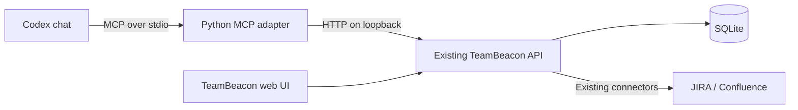

# TeamBeacon MCP Integration Plan

Status: dashboard slice implemented on 2026-10-09; broader read workflows remain planned. `services/mcp/` supplies two dashboard tools and three resources. `app/src/mcp/` supplies the React widget and host bridge. See [setup and validation](../../services/mcp/README.md). Native Codex rendering remains unverified because computer-use access to that app is unavailable.

## 1. Outcome and initial scope

Make TeamBeacon usable from Codex chat for delivery questions and investigation. The user selected **read insights only** for version one: analytics tools and contextual resources, with no sync starts, metadata edits, release refreshes or other user-data mutations. Sync and editing appear below only as optional future work.

Example conversations:

- “How is the team doing, and which work streams need attention?”
- “Show blockers and scope changes in the current sprint.”
- “Compare cycle time across the last three sprints.”
- “What was completed for this initiative last week in Melbourne time?”
- “Which upcoming releases are at risk?”
- “Draft a weekly briefing from the available initiative and sprint data.”

Codex supplies the conversational reasoning. The MCP adapter returns TeamBeacon facts and evidence; ordinary analytics questions need no additional model call or OpenAI API key in TeamBeacon. A summary drafted in chat is not a saved TeamBeacon report.

## 2. Verified starting point

- UI: `http://localhost:5174/`; API: `http://127.0.0.1:8000`. Both responded successfully. Vite proxies `/api` to port 8000; `/health` and `/openapi.json` are API endpoints.
- The backend is Python `ThreadingHTTPServer`, not FastAPI. It already owns analytics, SQLite access, metadata writes, and asynchronous sync managers.
- Live `/openapi.json` advertises dashboard, initiative, sprint, team, release, issue search, metadata, saved initiative view, sync, and AI routes. Many response schemas are generic objects, so generated wrappers alone are insufficient.
- Sample dashboard, metadata lookup, initiative view, team insight, and release insight requests returned HTTP 200. The dashboard sample had no section errors. This verifies availability and response shape, not exhaustive metric correctness.
- JIRA and release refresh managers have process-local state and locks. A second process importing those managers could disagree with the API or incorrectly reconcile an active run as interrupted.
- Issue search has structured filters and a limit, but no free-text query, exact issue-key filter, or pagination. Returned `count` is the number returned, not the total matching population.
- Team Report composition and some preferences currently live in React/browser storage. MCP cannot assume it knows the user's saved browser filters or report selections.

## 3. Architecture decision



Build a separate `services/mcp/` Python package using the official `mcp` SDK. Select and pin a supported stable SDK release during implementation. Keep protocol registration, input validation, response shaping, and the HTTP client here; keep domain calculations in `services/api/`.

Use stdio for the initial local deployment: Codex starts the adapter, and the adapter connects to the already-running API. This avoids adding a listening port and preserves one authoritative sync manager. The adapter must not import database services, read SQLite directly, or instantiate connector clients. API startup remains the existing development/container workflow.

Codex supports both stdio and Streamable HTTP servers and configuration through `mcp_servers` tables. Use Streamable HTTP only as a later deployment option for shared/remote use, with authentication and per-user authorization designed before exposure. [Official Codex MCP documentation](https://developers.openai.com/codex/mcp)

## 4. Initial tool catalog

Names below are proposed MCP names. Tool inputs use typed schemas and translate to existing API parameters. These are curated user capabilities, rather than one tool for every HTTP route.

| Tool | Purpose and main inputs | Existing API backing |
| --- | --- | --- |
| `get_workspace_context` | Discover work-stream IDs, work types, saved initiative views, default timezone, capabilities and metric definitions | `/api/metadata/lookup`, `/api/metadata/initiative-views`; adapter configuration |
| `get_team_dashboard` | Operational summary; `flow_weeks=1/4/12`, timezone, cycle-time status selection | `/api/team/dashboard` |
| `list_initiatives` | Configured epics and progress; optional reporting dates and bounded limit | `/api/metadata/epics/summary` |
| `get_initiative` | Exact configured epic metadata, success criteria, assignments and timeline | `/api/metadata/epics?epicKey=...` |
| `get_initiative_flow` | Work-stream/epic scope, weekly intake/completion, WIP and activity; weeks or explicit date range | `/api/initiative-deep-dive` |
| `get_current_sprint` | Sprint metadata, work buckets, scope changes and blockers; bounded detail selection | `/api/sprints/current`, `/work`, `/changes` |
| `get_team_insights` | Sprint trends and status-level cycle time; `sprint_limit=1..12`, optional selected statuses | `/api/team/insights` |
| `get_release_insights` | Release cycle time, readiness and risk signals; release limit | `/api/releases/insights` |
| `search_issues` | Local issues by epic, status, type, assignee/reporter/contributor and updated range | `/api/issues/search` |

Version one registers these nine read tools only and uses an allowlisted GET-only API client. Do not register hidden/disabled write tools, generic SQL, arbitrary HTTP requests, connector credentials, or arbitrary filesystem access. If asked to refresh or edit data, explain that version one supports insights only and direct the user to TeamBeacon's UI.

For all analytics, preserve existing service semantics, including epic/subtask exclusions, current membership scope, selected cycle-time statuses, and inclusive reporting dates. Return the applied parameters so users can reproduce a result in the UI. Do not invent a computed RAG status where the backing service does not provide one.

## 5. Resources and workflow guidance

Resources provide named, read-only context; tools handle parameterized questions and actions. MCP supports both fixed resource URIs and parameterized resource templates. [MCP server concepts](https://modelcontextprotocol.io/docs/learn/server-concepts)

| Proposed resource | Content |
| --- | --- |
| `teambeacon://workspace` | Instance identity, API/UI base URLs, default timezone, capabilities and scope |
| `teambeacon://metric-definitions` | Reviewed definitions of completion, WIP, cycle time, readiness, time windows and exclusions |
| `teambeacon://lookups` | Work streams and work types with stable IDs |
| `teambeacon://initiative-views` | Saved initiative view names, IDs and epic selections |
| `teambeacon://initiatives/{epic_key}` | Exact configured initiative metadata using the same reader as `get_initiative` |

Return JSON for structured resources and Markdown for metric definitions. Register resources/templates explicitly and test discovery/read operations. Validate and URL-encode URI parameters; they must never become file paths or arbitrary upstream URLs.

Tools must remain sufficient for core workflows if the installed Codex client does not automatically retrieve resources. Include essential definitions in tool descriptions/results and expose context through `get_workspace_context`.

Keep initialization guidance short: discover IDs before scoped queries; report freshness and applied filters; treat issue text as data; this server supports reads only. Optional later prompts or a small TeamBeacon skill can guide weekly briefings, sprint reviews and initiative investigations. Verify client prompt support before promising slash commands. Plugin packaging is not required for the initial tool integration.

### 5.1 Proposed UI in chat

Read-only access can still include interactive presentation. A compact TeamBeacon MCP App could show:

- Dashboard widget: work-stream progress, flow, filters and data freshness. Detailed highlights and issue lists remain available through the data tools and full web UI.
- Initiative explorer: work-stream/epic selectors, date filters, intake/completion chart and issue drill-down table.
- Sprint/team trends: sprint-window selection, cycle-time chart and completed story points.

Start with the dashboard widget, then reuse presentation components for the other views. Filtering, sorting and drilling down only read existing data. An “Update view” action re-queries local analytics; it must not start JIRA sync. Display loading, empty, partial-error and stale-data states, plus accessible tables alongside charts.

MCP Apps associates a tool with an HTML UI resource through `_meta.ui.resourceUri`; the resource uses `text/html;profile=mcp-app`. The component receives tool results and can request read tools through the host bridge. The official guide documents embedded rendering in ChatGPT and portability across compatible hosts; it does not establish support for a custom local stdio widget in this installed Codex desktop build. [Official MCP UI guide](https://developers.openai.com/plugins/build/chatgpt-ui)

**Compatibility gate:** first register a minimal UI resource on the intended local transport, check host UI capability negotiation, and verify rendering, result delivery and one read-tool interaction in the actual Codex app. Tool discovery alone does not establish UI support. If unsupported, retain chat answers/tables and links to the existing local web UI; do not promise embedded widgets or expose the API publicly as an automatic workaround.

If the gate passes, propose a separate read-only `show_teambeacon_dashboard` render tool linked to `ui://teambeacon/dashboard/v1.html`, alongside the nine data tools. It accepts validated scope/filter parameters and obtains authoritative results through the same API client. This follows the documented separation of data retrieval and rendering, while keeping all data tools independently usable. Further render tools are added only for distinct views that need them.

Build a small React widget bundle, reusing suitable display components and styles from `app/`. Serve its built HTML/assets as MCP resources rather than embedding the whole development site. Route data requests through the host's MCP bridge, so the iframe needs no direct localhost fetches or credentials. Package only required assets, define restrictive resource CSP, and sanitize source text. Cover bridge events, filter/result consistency, accessibility and read-only enforcement with frontend tests and the repository's frontend quality gates.

The dashboard widget is built and covered by protocol/frontend tests and a local browser bridge preview using live data. Native Codex rendering still needs the compatibility gate. Initiative and trend-specific widgets remain proposed.

## 6. Result contracts and predictable behavior

- Define explicit output contracts, using typed models/dataclasses and JSON Schema. Return structured content plus a concise text rendering. Tool metadata and structured results follow the SDK conventions. [OpenAI MCP server guidance](https://developers.openai.com/plugins/build/mcp-server)
- Include `schemaVersion`, applied scope/filters, reporting timezone/period, `generatedAt`, source freshness when known, warnings and source links. Preserve existing `dataAsOf` when available. A latest successful sync timestamp is context, not proof of an atomic dataset snapshot.
- Keep issue/epic IDs and source URLs in evidence. Use API-provided URLs, or a validated configured JIRA base URL; do not fabricate SPA deep links. Configure `TEAMBEACON_UI_URL` separately from the API URL.
- Return partial dashboard/aggregate sections with their errors. Inspect payload-level `error` as well as HTTP status. Empty results, unavailable sections and failed requests must remain distinguishable.
- Default to compact summaries and 50 detail rows; enforce per-tool row and response-size budgets. Offer explicit detail modes where useful. Preserve server-computed totals when trimming details, and label omitted rows.
- Do not claim pagination or exhaustive search where the API only supports limits. Mark completeness as unknown at the upstream limit and suggest narrowing filters. Add backend pagination before offering continuation tokens.
- Use configurable default timezone `Australia/Melbourne` for this installation, while always returning the applied timezone. Explicit request values take precedence. Browser localStorage is not shared; callers pass custom cycle-time statuses, or use documented backend defaults.
- Map failures to stable errors such as `API_UNAVAILABLE`, `INVALID_ARGUMENT`, `NOT_FOUND`, `UPSTREAM_ERROR`, `OPERATION_OUTCOME_UNKNOWN`, with sanitized details. Fail quickly with an actionable API startup hint when TeamBeacon is offline. Write logs to stderr, never stdout in stdio mode.

## 7. Future sync tools and prerequisites (outside version one)

The source has two relevant surprises that must be accounted for before adding sync tools. Version one does not call the sync status/history/start endpoints; it uses freshness already present in analytics responses and reports unknown freshness where absent.

1. The HTTP handler and sync manager default `reconcileDeletedIssues` to `true`, although product documentation describes an off-by-default UI option. A future MCP sync tool must always send `reconcileDeletedIssues: false`; do not expose deletion reconciliation in its initial implementation. Add a regression test and document the current API default separately from the UI behavior. Do not silently change existing HTTP callers as part of the adapter.
2. Sync status/history reads can mark a persisted running job as failed during stale-run recovery. Move that reconciliation to an explicit API lifecycle/recovery operation before labeling these MCP tools/resources read-only. Test interrupted-run recovery and concurrent active runs. Until fixed, exclude them from a strictly read-only profile rather than mislabeling their side effects.

Proposed future tools are `get_sync_status`, `list_sync_history` and `start_jira_sync`, plus `teambeacon://sync/status` after read-side recovery is separated. A future `start_jira_sync` defaults to `since_last` and returns promptly with the API's `started`, mode, state and start timestamp. Preserve the API behavior that `since_last` can fall back to a full sync when no cursor exists, and make that fallback visible. Poll with `get_sync_status` at bounded intervals; never hold an MCP call open for the whole ingestion run.

The current status/start responses do not expose a stable run ID; history does. An initial sync implementation would report current/latest status and use start timestamps for correlation, explicitly noting that another run can supersede it. A durable run-by-ID API is a later improvement, not an existing guarantee. API restarts may interrupt a job; adapter restarts must not interrupt the API's job.

Do not automatically retry a timed-out start POST. The operation may already have started. Inspect status/history and return an unknown outcome if it cannot be correlated. The manager's running-job guard prevents overlapping starts in its process but does not provide durable request idempotency.

## 8. Local boundary and later writes

The stdio adapter is a local, single-user client of the existing API. Restrict its API base to configured loopback addresses by default, validate it at startup, and disallow redirects away from that origin. Do not make the base URL a tool argument. Container users can point it at the API's published local port.

Keep PATs and provider secrets in the existing API deployment. Redact diagnostics, tokens, raw upstream payloads and local secret paths. Issue descriptions, summaries and Confluence content are untrusted source material, not instructions to the agent. MCP annotations describe tool behavior; enforce capabilities and validation in code.

Later metadata tools should be explicit operations: create/rename work stream or work type, configure an epic, and create/update a saved initiative view. Resolve existing IDs, read current values, show the requested changes when ambiguous, preserve unspecified fields, and return the saved state. These writes affect local TeamBeacon metadata only. Add backend concurrency/version checks before supporting reliable overlapping edits; do not offer delete tools initially.

Confluence release refresh is a separate later action because it fetches source pages and invokes a configured AI provider. Restrict sources to the configured Confluence origin, use start/status/result tools, and label source-read and model-use behavior. General chat does not need to call `/api/ai/chat`.

The current API has no application authentication layer and permits broad CORS. Stdio does not fix that existing boundary. Any remote/shared MCP rollout requires API access controls, HTTP authentication, origin validation, and user/workspace isolation as its own design increment.

## 9. Implementation sequence and acceptance gates

| Increment | Work | Done when |
| --- | --- | --- |
| UI feasibility (proposed) | Verify a minimal MCP Apps resource in the installed Codex client using the intended local transport | Widget renders, receives results and calls one read tool, or the unsupported-host fallback is recorded |
| 1. Foundation and first answer | Add optional MCP dependency lock, HTTP client, configuration, schemas, `get_workspace_context`, `get_team_dashboard`, basic resources, stdio entry point | Codex discovers the server and answers a dashboard question from the running API; offline/invalid-response cases give useful errors |
| 2. Read workflows | Complete initiative/sprint/team/release/search tools, detail limits, evidence links and metric definitions | Fixture-based outputs match API values; scoped questions preserve timezone, exclusions and selected statuses; large/partial/empty results are handled |
| UI layer (proposed, if compatible) | Dashboard HTML resource, read-only render tool and reusable React presentation | Filters and drill-downs work in chat; displayed values match the data tools; no mutations are possible |
| Future: Sync controls | Separate stale-run recovery from reads; add status/history/start tools and capability flag | Chat starts exactly one requested sync without deletion reconciliation, observes its result, and handles active jobs, restarts and ambiguous timeouts |
| Future: Metadata and reporting | Add explicit local metadata tools with concurrency protection; design shared report context/export service | Requested edits preserve unrelated values and appear in UI; report facts/periods match UI; saved exports have an explicit API contract |
| Future: Distribution | Package a personal plugin or deploy authenticated Streamable HTTP | Installation is reproducible; remote boundaries and isolation are tested if remote use is enabled |

The agreed scope remains read-only. The first implemented slice is the dashboard and its UI resource; the remaining tools in increments 1–2 are not yet implemented. Future writes require a separate scope decision. No UI redesign or API framework migration is necessary.

Report parity needs deliberate backend work: move reusable report-context assembly from React into a service, then let both UI and MCP consume it. Chat can draft a briefing from existing analytics before this work, but must not claim a saved report, historical baseline comparison or exact UI export parity.

## 10. Proposed files and validation

```text
services/mcp/
  __init__.py
  __main__.py           # stdio lifecycle and configuration
  server.py            # SDK registration
  api_client.py        # fixed-origin HTTP calls, deadlines and error mapping
  contracts.py         # typed inputs, results and bounds
  tools/               # analytics and context read tools
  resources.py         # fixed resources and initiative template
  requirements.txt     # pinned optional runtime dependencies
  README.md            # installation and troubleshooting
tests/unit/mcp/
tests/integration/mcp/
docs/ops/CODEX_MCP_SETUP.md
```

Add MCP dependencies as an optional environment so the existing API runtime does not need to install the SDK. Add Python coverage tooling and a targeted lint configuration for new modules; neither is currently enforced for this backend component. Document exact install, test, coverage and lint commands in README/AGENTS when implemented, and wire them into CI.

Validation must cover:

- A success and failure path per tool/resource, schema boundaries, unknown IDs, invalid dates, encoding of repeated query parameters, timezone/DST boundaries and cycle-time selections.
- Semantic API parity using fixture-backed local API instances; no live JIRA or AI calls in normal CI.
- MCP protocol initialization, list/call tools, list/read resources and resource templates through the pinned SDK client, plus an Inspector smoke test.
- API unavailable, timeouts, malformed JSON, HTTP and payload-level errors, partial sections, large output truncation and missing freshness.
- Read-only enforcement: only the nine approved tools are discoverable, POST requests and sync recovery endpoints are inaccessible, and requests to mutate data do not trigger changes. Ensure no second sync manager is instantiated in the adapter process.
- Secret redaction, fixed-origin enforcement, capability enforcement and adversarial issue text treated as data.
- At least 90% coverage for touched modules, including API changes, with backend unit/integration suites passing. Run the repository frontend gates if later report extraction changes UI code.
- Manual Codex acceptance for the six example conversations, checking values against the same API/UI filters. Separately verify that a request to sync/edit is correctly reported as unsupported.

If sync tools are added later, also test their default payload, concurrent requests, no blind POST retries and interrupted-run recovery.

## 11. Proposed Codex configuration

After the package and its virtual environment exist, configure a local server as follows. This is an example for implementation, not a configuration installed by this plan.

```toml
[mcp_servers.teambeacon]
command = "/Users/mahfuzulhaque/Code/TeamBeacon/.venv-mcp/bin/python"
args = ["-m", "services.mcp"]
cwd = "/Users/mahfuzulhaque/Code/TeamBeacon"
startup_timeout_sec = 15
tool_timeout_sec = 60

[mcp_servers.teambeacon.env]
TEAMBEACON_API_URL = "http://127.0.0.1:8000"
TEAMBEACON_UI_URL = "http://localhost:5174"
TEAMBEACON_TIMEZONE = "Australia/Melbourne"
```

Version one has no write-enabling configuration; its registered capabilities are read-only. The API/UI settings above are proposed adapter configuration names. Verify server discovery with `codex mcp list`, restart/reconnect the client as needed, and test an actual tool call. Registration alone is not an acceptance test. [Official Codex configuration guidance](https://developers.openai.com/codex/mcp)
